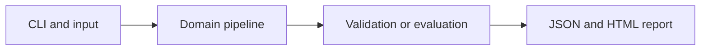

# Variational Autoencoder for Synthetic Expression

Train a variational autoencoder on low-dimensional fictional expression profiles and sample new mathematical profiles.

**Category:** Biology / Deep Generative Learning

**Execution:** Actual local algorithm or workflow; no external model service required.

## Run

```sh
python -m venv .venv
# Windows: .venv\Scripts\activate
# macOS/Linux: source .venv/bin/activate
python -m pip install -r requirements.txt
python app.py
python -m unittest discover -v
```

Open `results/report.html` after running. Python 3.10+ is required. Use `--help` for input and seed options.

## Architecture



## Algorithm

Encode standardized expression through tanh into Gaussian latent means and log variances. Use reparameterization z=mu+exp(logvar/2)*epsilon and a linear decoder. Optimize squared reconstruction plus beta-weighted KL divergence with analytic gradients.

## Evaluation

Train on 500 fictional profiles and evaluate reconstruction on 200 independent profiles. Compare with a training-mean baseline; save generated profiles and run a fixed-noise numerical gradient check.

## Limitations

Generated values are standardized mathematical profiles, not validated cell states, count measurements or treatment predictions. The model is not scVI and has no biological foundation-model pretraining.

## Documentation

- [PDF project guide](PROJECT_GUIDE.pdf)
- [Editable guide](GUIDE.md)
- [Model and system card](MODEL_CARD.md)
- [Measured results](results/metrics.json)
- [Test output](TEST_RESULTS.txt)

## Extend it

Use appropriate count likelihoods, donor and batch covariates, posterior predictive checks and licensed expression data before biological interpretation.

AI-assisted educational project with synthetic data. Review, customize and explain your own contribution accurately. MIT license.

## Biology scope and current relevance

Default inputs are synthetic or project-authored. No clinical deployment or wet-lab validation is claimed. See [research context](RESEARCH_CONTEXT.md) and [data provenance](DATA_PROVENANCE.md).

- [Universal cell embedding provides a foundation model for cell biology](https://www.nature.com/articles/s41586-026-10689-z) (2026)
